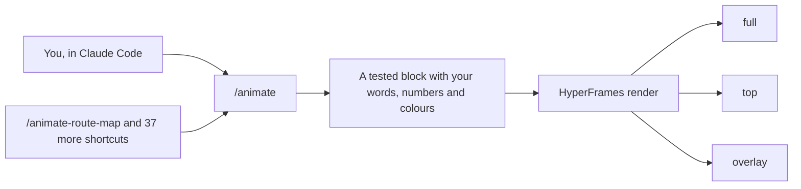

<p align="center">
  <a href="https://ctskool.github.io/chase-animations/"></a>
</p>

<p align="center">
  <b>38 finished animations for vertical video.</b><br>
  Tell Claude Code what to show, and the key moment lands on the word you say.
</p>

<p align="center">
  
  
  
  
</p>

<p align="center">
  <a href="https://ctskool.github.io/chase-animations/"><b>Watch the gallery</b></a>
  &nbsp;·&nbsp;
  <a href="#the-animations">All animations</a>
  &nbsp;·&nbsp;
  <a href="#start-here">Start here</a>
  &nbsp;·&nbsp;
  <a href="docs/COMMANDS.md">Commands</a>
</p>

## Say it, and it lands

```text
/animate head-to-head on the word "cheaper" in my-video.mp4, Cursor vs Claude Code
```

Claude asks for anything it's missing, renders the animation, checks the frames and gives you the file, with your audio untouched.

- **It lands on your word.** The pack transcribes your video on your own computer and times the key moment to the word you pick.
- **It isn't a prompt you hope comes out right.** Each animation is a tested [HyperFrames](https://hyperframes.heygen.com) block with text, numbers and colours you can edit.
- **It works with real data.** Route map draws real trips on real streets from two place names or a GPX file, with no API key.

## One animation, three outputs

<table>
<tr>
<td width="33%" align="center" valign="top"><br><b><code>full</code></b><br><sub>1080x1920, a full-screen cutaway</sub></td>
<td width="33%" align="center" valign="top"><br><b><code>top</code></b><br><sub>1080x960, the top half of a split-screen, with you below</sub></td>
<td width="33%" align="center" valign="top"><br><b><code>overlay</code></b><br><sub>1080x1920 and transparent, floating over you</sub></td>
</tr>
</table>

## The animations

Every clip here is a real render on sample content. For larger versions with each key moment and the command that runs it, [open the gallery](https://ctskool.github.io/chase-animations/).

<!-- animations:start -->

### Real routes

Route map on real streets, water and 3D buildings. Name two places or give it a GPX file.

<table>
<tr>
<td width="25%" align="center" valign="top">
<a href="blocks/route-map/README.md"></a>
<br><b>Tower Bridge to St Paul's</b><br><sub>A 1.4 mile walk through real London</sub>
</td>
<td width="25%" align="center" valign="top">
<a href="blocks/route-map/README.md"></a>
<br><b>Millennium Park to Navy Pier</b><br><sub>A 1.8 mile drive along the Chicago lakefront</sub>
</td>
<td width="25%" align="center" valign="top">
<a href="blocks/route-map/README.md"></a>
<br><b>Palace of Fine Arts to the Wharf</b><br><sub>A 2.2 mile bike ride along the San Francisco bay</sub>
</td>
</tr>
</table>

### Compare and prove

<table>
<tr>
<td width="25%" align="center" valign="top">
<a href="blocks/head-to-head/README.md"></a>
<br><b><a href="blocks/head-to-head/README.md"><code>head-to-head</code></a></b><br><sub>Two options compared row by row, ending on one payoff stat</sub>
</td>
<td width="25%" align="center" valign="top">
<a href="blocks/before-after/README.md"></a>
<br><b><a href="blocks/before-after/README.md"><code>before-after</code></a></b><br><sub>A handle wipes a website from its old design to its new one</sub>
</td>
<td width="25%" align="center" valign="top">
<a href="blocks/ranking-bars/README.md"></a>
<br><b><a href="blocks/ranking-bars/README.md"><code>ranking-bars</code></a></b><br><sub>Bars race through changing years with one hero to follow</sub>
</td>
<td width="25%" align="center" valign="top">
<a href="blocks/money-stat/README.md"></a>
<br><b><a href="blocks/money-stat/README.md"><code>money-stat</code></a></b><br><sub>One huge counter climbs a chart past its turning point</sub>
</td>
</tr>
<tr>
<td width="25%" align="center" valign="top">
<a href="blocks/notification-stack/README.md"></a>
<br><b><a href="blocks/notification-stack/README.md"><code>notification-stack</code></a></b><br><sub>Orders flood a lock screen while the total counts up</sub>
</td>
<td width="25%" align="center" valign="top">
<a href="blocks/post-receipt/README.md"></a>
<br><b><a href="blocks/post-receipt/README.md"><code>post-receipt</code></a></b><br><sub>A social post with racing counts and quote replies</sub>
</td>
<td width="25%" align="center" valign="top">
<a href="blocks/headline-highlight/README.md"></a>
<br><b><a href="blocks/headline-highlight/README.md"><code>headline-highlight</code></a></b><br><sub>A newspaper flies in and a highlighter marks the evidence</sub>
</td>
<td width="25%" align="center" valign="top">
<a href="blocks/evidence-desk/README.md"></a>
<br><b><a href="blocks/evidence-desk/README.md"><code>evidence-desk</code></a></b><br><sub>Papers on a desk with a figure circled in red</sub>
</td>
</tr>
<tr>
<td width="25%" align="center" valign="top">
<a href="blocks/day-card/README.md"></a>
<br><b><a href="blocks/day-card/README.md"><code>day-card</code></a></b><br><sub>A huge day counter stamps through a calendar</sub>
</td>
</tr>
</table>

### Products and apps

<table>
<tr>
<td width="25%" align="center" valign="top">
<a href="blocks/screen-zoom/README.md"></a>
<br><b><a href="blocks/screen-zoom/README.md"><code>screen-zoom</code></a></b><br><sub>The cursor leads the camera to one button, and it clicks</sub>
</td>
<td width="25%" align="center" valign="top">
<a href="blocks/app-launch/README.md"></a>
<br><b><a href="blocks/app-launch/README.md"><code>app-launch</code></a></b><br><sub>A studio phone receives a transaction and completes it</sub>
</td>
<td width="25%" align="center" valign="top">
<a href="blocks/laptop-reveal/README.md"></a>
<br><b><a href="blocks/laptop-reveal/README.md"><code>laptop-reveal</code></a></b><br><sub>A laptop opens, wakes on your product and scrolls it</sub>
</td>
<td width="25%" align="center" valign="top">
<a href="blocks/apple-one-take/README.md"></a>
<br><b><a href="blocks/apple-one-take/README.md"><code>apple-one-take</code></a></b><br><sub>A dot morphs through a button, a planner and a phone in one take</sub>
</td>
</tr>
<tr>
<td width="25%" align="center" valign="top">
<a href="blocks/frosted-glass/README.md"></a>
<br><b><a href="blocks/frosted-glass/README.md"><code>frosted-glass</code></a></b><br><sub>A glass search bar docks above results and picks one</sub>
</td>
<td width="25%" align="center" valign="top">
<a href="blocks/exploded-teardown/README.md"></a>
<br><b><a href="blocks/exploded-teardown/README.md"><code>exploded-teardown</code></a></b><br><sub>A product opens into labelled layers</sub>
</td>
</tr>
</table>

### Explain a process or place

<table>
<tr>
<td width="25%" align="center" valign="top">
<a href="blocks/isometric-flow/README.md"></a>
<br><b><a href="blocks/isometric-flow/README.md"><code>isometric-flow</code></a></b><br><sub>A 3D diorama of a three-step process</sub>
</td>
<td width="25%" align="center" valign="top">
<a href="blocks/timeline-3d/README.md"></a>
<br><b><a href="blocks/timeline-3d/README.md"><code>timeline-3d</code></a></b><br><sub>A moving rail passes oversized milestone cards</sub>
</td>
<td width="25%" align="center" valign="top">
<a href="blocks/globe-arcs/README.md"></a>
<br><b><a href="blocks/globe-arcs/README.md"><code>globe-arcs</code></a></b><br><sub>Routes cross a dotted globe while a figure counts up</sub>
</td>
<td width="25%" align="center" valign="top">
<a href="blocks/route-map/README.md"></a>
<br><b><a href="blocks/route-map/README.md"><code>route-map</code></a></b><br><sub>A route draws through a pale 3D city, fictional or real, with live trip stats</sub>
</td>
</tr>
<tr>
<td width="25%" align="center" valign="top">
<a href="blocks/pencil-blueprint/README.md"></a>
<br><b><a href="blocks/pencil-blueprint/README.md"><code>pencil-blueprint</code></a></b><br><sub>A graphite sketch becomes a white-on-blue technical drawing</sub>
</td>
</tr>
</table>

### Styled titles

<table>
<tr>
<td width="25%" align="center" valign="top">
<a href="blocks/blue-editorial/README.md"></a>
<br><b><a href="blocks/blue-editorial/README.md"><code>blue-editorial</code></a></b><br><sub>An ultramarine cover with frame-filling italic words</sub>
</td>
<td width="25%" align="center" valign="top">
<a href="blocks/swiss-grid/README.md"></a>
<br><b><a href="blocks/swiss-grid/README.md"><code>swiss-grid</code></a></b><br><sub>A black circle and red field in a strict Swiss grid</sub>
</td>
<td width="25%" align="center" valign="top">
<a href="blocks/magazine-layout/README.md"></a>
<br><b><a href="blocks/magazine-layout/README.md"><code>magazine-layout</code></a></b><br><sub>A painted image, a serif headline and a real text column</sub>
</td>
<td width="25%" align="center" valign="top">
<a href="blocks/risograph/README.md"></a>
<br><b><a href="blocks/risograph/README.md"><code>risograph</code></a></b><br><sub>A two-ink poster prints in stepped passes</sub>
</td>
</tr>
<tr>
<td width="25%" align="center" valign="top">
<a href="blocks/ink-wash/README.md"></a>
<br><b><a href="blocks/ink-wash/README.md"><code>ink-wash</code></a></b><br><sub>Mountains, a red sun and a small boat on rice paper</sub>
</td>
<td width="25%" align="center" valign="top">
<a href="blocks/glow-orb/README.md"></a>
<br><b><a href="blocks/glow-orb/README.md"><code>glow-orb</code></a></b><br><sub>A soft breathing orb above one line of type</sub>
</td>
<td width="25%" align="center" valign="top">
<a href="blocks/retro-crt/README.md"></a>
<br><b><a href="blocks/retro-crt/README.md"><code>retro-crt</code></a></b><br><sub>A beam opens into a huge phosphor title with a terminal line</sub>
</td>
<td width="25%" align="center" valign="top">
<a href="blocks/oscilloscope/README.md"></a>
<br><b><a href="blocks/oscilloscope/README.md"><code>oscilloscope</code></a></b><br><sub>A green signal folds through figures and writes your words</sub>
</td>
</tr>
</table>

### Claude Code

These use Claude Code's look, the Claude logo and its pixel mascot. They run on sample content until you tell Claude what to show, and you can turn the mascot or logo off.

<table>
<tr>
<td width="25%" align="center" valign="top">
<a href="blocks/terminal-run/README.md"></a>
<br><b><a href="blocks/terminal-run/README.md"><code>terminal-run</code></a></b><br><sub>A session plays out from one prompt to a finished result</sub>
</td>
<td width="25%" align="center" valign="top">
<a href="blocks/agent-fan-out/README.md"></a>
<br><b><a href="blocks/agent-fan-out/README.md"><code>agent-fan-out</code></a></b><br><sub>One prompt splits into six subagents, each with its own mascot</sub>
</td>
<td width="25%" align="center" valign="top">
<a href="blocks/agent-loop/README.md"></a>
<br><b><a href="blocks/agent-loop/README.md"><code>agent-loop</code></a></b><br><sub>The mascot laps Plan, Act and Check until the tests pass</sub>
</td>
<td width="25%" align="center" valign="top">
<a href="blocks/test-sweep/README.md"></a>
<br><b><a href="blocks/test-sweep/README.md"><code>test-sweep</code></a></b><br><sub>A wall of failing tests flips green in a wave</sub>
</td>
</tr>
<tr>
<td width="25%" align="center" valign="top">
<a href="blocks/bug-hunt/README.md"></a>
<br><b><a href="blocks/bug-hunt/README.md"><code>bug-hunt</code></a></b><br><sub>The mascot surfs a scrolling file until it finds the bug</sub>
</td>
<td width="25%" align="center" valign="top">
<a href="blocks/file-tree/README.md"></a>
<br><b><a href="blocks/file-tree/README.md"><code>file-tree</code></a></b><br><sub>A codebase grows branch by branch behind the mascot</sub>
</td>
<td width="25%" align="center" valign="top">
<a href="blocks/diff-reveal/README.md"></a>
<br><b><a href="blocks/diff-reveal/README.md"><code>diff-reveal</code></a></b><br><sub>The mascot eats the red lines of a real-looking diff</sub>
</td>
<td width="25%" align="center" valign="top">
<a href="blocks/hours-collapse/README.md"></a>
<br><b><a href="blocks/hours-collapse/README.md"><code>hours-collapse</code></a></b><br><sub>A full day of hour blocks gets stomped into minutes</sub>
</td>
</tr>
<tr>
<td width="25%" align="center" valign="top">
<a href="blocks/cost-receipt/README.md"></a>
<br><b><a href="blocks/cost-receipt/README.md"><code>cost-receipt</code></a></b><br><sub>A till receipt prints line items for a session</sub>
</td>
<td width="25%" align="center" valign="top">
<a href="blocks/benchmark-takeover/README.md"></a>
<br><b><a href="blocks/benchmark-takeover/README.md"><code>benchmark-takeover</code></a></b><br><sub>The mascot rides a huge row into a serious leaderboard</sub>
</td>
</tr>
</table>

<!-- animations:end -->

## Start here

You need [Claude Code](https://claude.com/claude-code), [Node.js 22 or newer](https://nodejs.org) and FFmpeg.

```bash
git clone https://github.com/ctskool/chase-animations.git
```

```bash
cd chase-animations
```

```bash
npm install
```

```bash
npm run setup
```

Restart Claude Code and type `/animate`. To land animations on a spoken word, also add the speech model, about 640 MB, which runs on your computer:

```bash
npm run setup -- --speech
```

[docs/INSTALL.md](docs/INSTALL.md) has the full guide and fixes for common problems. Prefer the terminal? [docs/COMMANDS.md](docs/COMMANDS.md) has every command.

## How it's built



`/animate` does the work, and each animation has a typed shortcut that sends you straight to it. Fixes to rendering, word sync or the frame check live in one place, and each animation stays in its own folder.

| Folder | What's in it |
|---|---|
| [`blocks/`](blocks) | The 38 animations, each with its own README on what it suits and how to feed it |
| [`skills/`](skills) | `/animate` and its shortcuts |
| [`shared/`](shared) | Rendering, word sync, real routes and the `animate` command |
| [`gallery/`](gallery) | The gallery page, its clips and the catalogue behind it |
| [`docs/`](docs) | Install guide, commands and credits |

## What works where

| | |
|---|---|
| Windows 11 | Tested |
| Mac | **Untested.** It may work, but nobody has run it yet. [Open an issue](https://github.com/ctskool/chase-animations/issues) and say how it goes |
| Linux | Untested |

## Credits

Fonts, map data and third-party licences are listed in [docs/CREDITS.md](docs/CREDITS.md). Claude, Claude Code, the Claude logo and the Claude Code mascot are Anthropic's, and this pack isn't affiliated with or endorsed by Anthropic.
