<p align="center">
  <a href="https://ctskool.github.io/chase-animations/">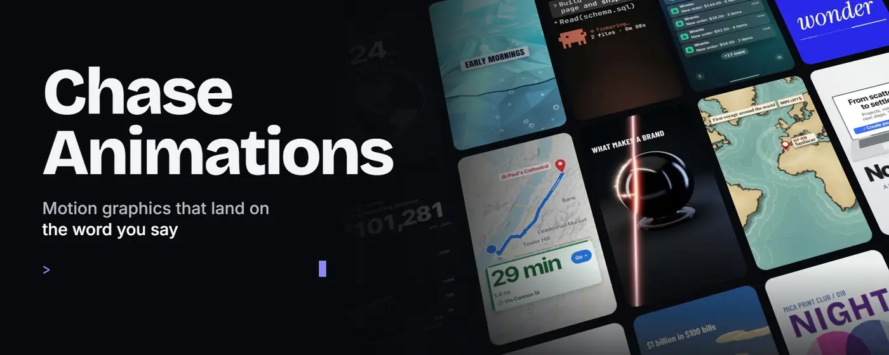</a>
</p>

<p align="center">
  <b>42 finished animations, a one-sentence explainer maker and effects for your own shot, for vertical video.</b><br>
  Three Claude Code skills. Tell Claude what to show, and it lands on the word you say.
</p>

<p align="center">
  
  
  
  
</p>

<p align="center">
  <a href="https://ctskool.github.io/chase-animations/"><b>Watch the gallery</b></a>
  &nbsp;·&nbsp;
  <a href="#animate-one-animation-on-your-word">/animate</a>
  &nbsp;·&nbsp;
  <a href="#explain-a-whole-explainer-from-one-sentence">/explain</a>
  &nbsp;·&nbsp;
  <a href="#vfx-effects-on-your-own-shot">/vfx</a>
  &nbsp;·&nbsp;
  <a href="#start-here">Start here</a>
  &nbsp;·&nbsp;
  <a href="docs/COMMANDS.md">Commands</a>
</p>

## Three skills

| | `/animate` | `/explain` | `/vfx` |
|---|---|---|---|
| **You give it** | An animation, your words and numbers, and optionally your video and a word in it | One sentence: "how X works" | Your talking-head clip, an effect and the word it lands on |
| **You get** | One animation, landed on that word in your video, or a clip for your editor | A finished 20 to 30 second explainer: script, your voice, 3D scenes and captions | Your own shot with the effect in it: cards behind your head, the lights dropping, a tier list above you |
| **Use it for** | A visual beat inside a video you've already filmed | A whole short, start to finish | A moment, a stretch, or a recurring move across a video you've filmed |
| **Your part** | Nothing beyond the request | Approve the script, then record it in one take | Film with some room around your head |

All three are installed together, run on your own computer, and are checked frame by frame before you get the file.

## /animate: one animation, on your word

```text
/animate head-to-head on the word "cheaper" in my-video.mp4, Cursor vs Claude Code
```

1. **Pick an animation.** Name one, or describe what you need and Claude suggests some. Each one also has its own shortcut, such as `/animate-iceberg` or `/animate-route-map`.
2. **Give it your content.** Claude asks for anything missing: your words, numbers and colours. It never invents a statistic.
3. **It lands on your word.** The pack transcribes your video on your own computer and times the animation's key moment to the word you pick, then places it into your video with your audio untouched. No video? You get a clip for your editor.
4. **It checks the result.** Claude looks at the key frames before handing it over.

- **It isn't a prompt you hope comes out right.** Each animation is a tested [HyperFrames](https://hyperframes.heygen.com) block with text, numbers and colours you can edit.
- **It works with real data.** Route map draws real trips on real streets from two place names or a GPX file, and Campaign map sweeps arrows across real places, with no API key.

### One animation, three outputs

<table>
<tr>
<td width="33%" align="center" valign="top">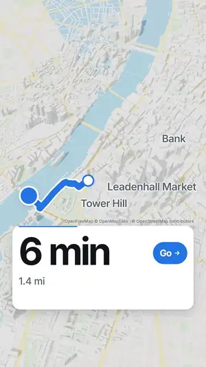<br><b><code>full</code></b><br><sub>1080x1920, a full-screen cutaway</sub></td>
<td width="33%" align="center" valign="top">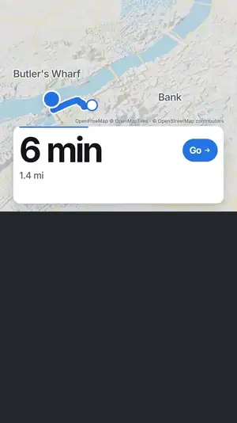<br><b><code>top</code></b><br><sub>1080x960, the top half of a split-screen, with you below</sub></td>
<td width="33%" align="center" valign="top">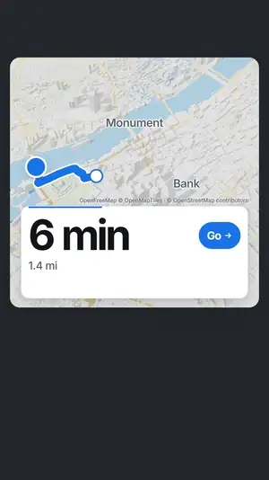<br><b><code>overlay</code></b><br><sub>1080x1920 and transparent, floating over you</sub></td>
</tr>
</table>

## /explain: a whole explainer from one sentence

<table>
<tr>
<td width="34%" valign="top">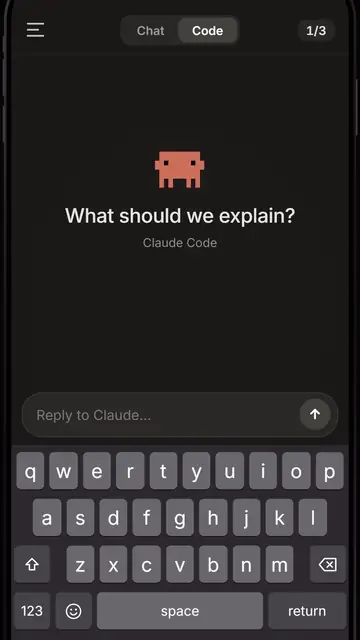</td>
<td valign="top">

```text
/explain how AI picks its next word
```

1. **Claude writes the script.** About 50 words, fact-checked, split into scenes, with the facts it relies on listed so you can check them.
2. **You approve it.** Ask for changes until it reads right. Nothing gets built until you say it's good.
3. **Preview it, if you like.** A silent version timed to a natural reading pace, so you see the video before you record.
4. **You record it.** One take on your phone or mic, in your own voice. A slip or a restart is fine. There's never a robot voice.
5. **It builds to your voice.** Your take is transcribed on your computer, and every scene and caption is timed to your actual speech. Captions land a few words at a time, with the key word boxed.
6. **You get the video.** A finished vertical MP4 with your narration, checked frame by frame.

</td>
</tr>
</table>

The scenes come from a kit of reusable cinematic 3D scene types, so every explainer looks consistent and builds quickly: a hero object, a labelled layer stack, things flowing between parts, a model network, a face scan, a fiber strand, ranked bars, a big number and more. When nothing fits, Claude writes a custom scene from a template.

These five were made with `/explain`, shown as silent previews:

<!-- explain:start -->

<table>
<tr>
<td width="25%" align="center" valign="top">
<a href="skills/explain/SKILL.md">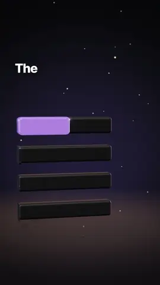</a>
<br><b>How AI picks its next word</b><br><sub>Your sentence becomes tokens and the likeliest next word wins</sub>
</td>
<td width="25%" align="center" valign="top">
<a href="skills/explain/SKILL.md">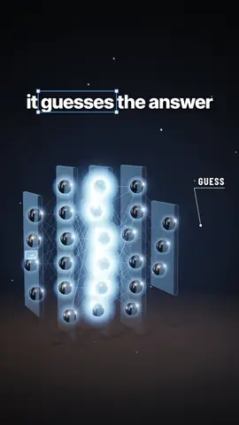</a>
<br><b>How AI learns from data</b><br><sub>Guesses flash red, the error flows back and accuracy climbs</sub>
</td>
<td width="25%" align="center" valign="top">
<a href="skills/explain/SKILL.md">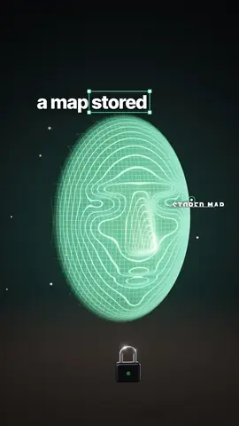</a>
<br><b>How face unlock works</b><br><sub>Infrared dots map a face in 3D and a padlock opens</sub>
</td>
<td width="25%" align="center" valign="top">
<a href="skills/explain/SKILL.md">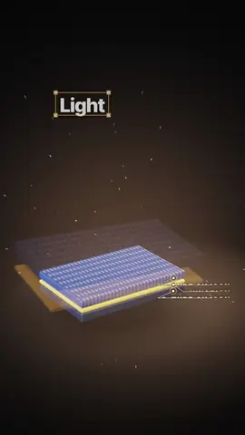</a>
<br><b>How solar panels make power</b><br><sub>Photons knock electrons loose and current lights a bulb</sub>
</td>
</tr>
<tr>
<td width="25%" align="center" valign="top">
<a href="skills/explain/SKILL.md">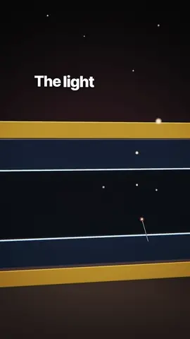</a>
<br><b>How fiber internet carries light</b><br><sub>A light pulse zig-zags down glass at 200,000 km a second</sub>
</td>
</tr>
</table>

<!-- explain:end -->

## /vfx: effects on your own shot

<table>
<tr>
<td width="34%" valign="top">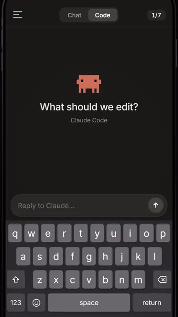</td>
<td valign="top">

```text
/vfx orbit on "five skills" in my-video.mp4
```

1. **Pick an effect and a moment.** Name the word, a stretch of seconds, or a rule for the whole video, like "every time I name a skill, drop it into the tier list".
2. **Claude finds the word.** Your video is transcribed on your computer, so the effect lands on what you actually said.
3. **You're cut out of your own shot.** Only for the few seconds the effect covers. That's what lets things sit behind your head and lets the room go dark while you stay lit.
4. **It's built around you.** A layer behind you, your cut-out, a layer in front, all following your head with a little weight.
5. **It checks the result.** Claude looks at the key frames, so nothing covers your face.

</td>
</tr>
</table>

Every effect uses your real words and numbers. These sixteen were made on one 85 second video, which is in [`examples/vfx/`](examples/vfx) with a 15 second sample clip to try it on:

<!-- vfx:start -->

<table>
<tr>
<td width="25%" align="center" valign="top">
<a href="skills/vfx/SKILL.md"></a>
<br><b>Glass widgets</b><br><sub>Frosted cards drop in around your head; the upper ones fall behind it</sub>
</td>
<td width="25%" align="center" valign="top">
<a href="skills/vfx/SKILL.md">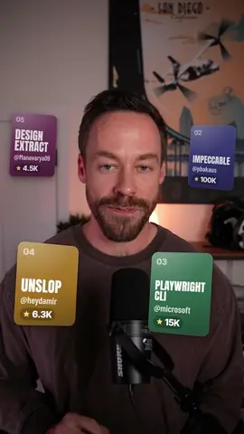</a>
<br><b>Orbit</b><br><sub>Your cards circle your head, sliding behind it on the far side</sub>
</td>
<td width="25%" align="center" valign="top">
<a href="skills/vfx/SKILL.md"></a>
<br><b>Snap</b><br><sub>A hard punch-in on your face on one word</sub>
</td>
<td width="25%" align="center" valign="top">
<a href="skills/vfx/SKILL.md"></a>
<br><b>Push</b><br><sub>A slow push-in while the room behind you goes soft and you stay sharp</sub>
</td>
</tr>
<tr>
<td width="25%" align="center" valign="top">
<a href="skills/vfx/SKILL.md">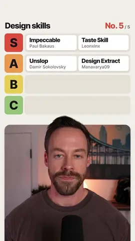</a>
<br><b>Tier list</b><br><sub>A tier board above you; each thing you name slams into its row</sub>
</td>
<td width="25%" align="center" valign="top">
<a href="skills/vfx/SKILL.md">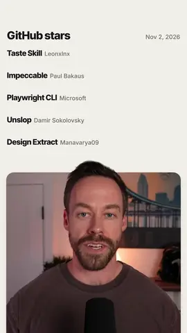</a>
<br><b>Chart split</b><br><sub>A bar chart above you; the bars you compare shoot out at their real value</sub>
</td>
<td width="25%" align="center" valign="top">
<a href="skills/vfx/SKILL.md">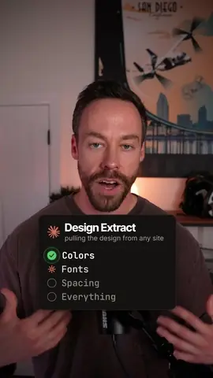</a>
<br><b>Checklist</b><br><sub>A Claude Code task card ticks each item green as you say it</sub>
</td>
<td width="25%" align="center" valign="top">
<a href="skills/vfx/SKILL.md"></a>
<br><b>Spotlight</b><br><sub>The room drops to black and a glowing word buzzes on behind your head</sub>
</td>
</tr>
<tr>
<td width="25%" align="center" valign="top">
<a href="skills/vfx/SKILL.md"></a>
<br><b>Browser stack</b><br><sub>Browser windows pile up behind you, then each one gets a green Passed</sub>
</td>
<td width="25%" align="center" valign="top">
<a href="skills/vfx/SKILL.md"></a>
<br><b>Backdrop</b><br><sub>Any animation from the pack becomes the room behind you</sub>
</td>
<td width="25%" align="center" valign="top">
<a href="skills/vfx/SKILL.md">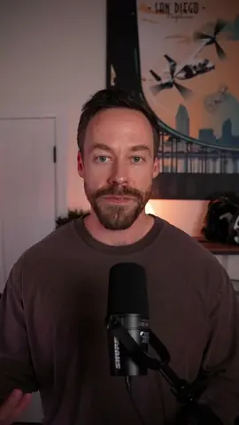</a>
<br><b>Echo</b><br><sub>Your keywords land huge behind your head the moment you say them</sub>
</td>
<td width="25%" align="center" valign="top">
<a href="skills/vfx/SKILL.md">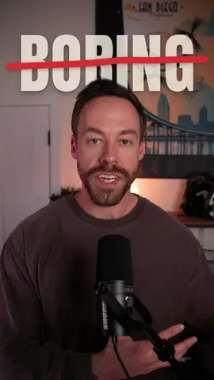</a>
<br><b>Strike</b><br><sub>A giant word behind you gets crossed out, then the right word drops in</sub>
</td>
</tr>
<tr>
<td width="25%" align="center" valign="top">
<a href="skills/vfx/SKILL.md">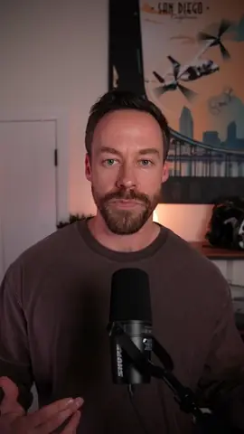</a>
<br><b>Pinned comment</b><br><sub>The comment you're answering pins beside your head and types itself out</sub>
</td>
<td width="25%" align="center" valign="top">
<a href="skills/vfx/SKILL.md">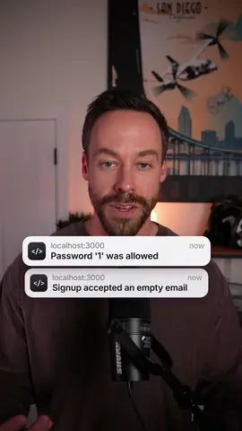</a>
<br><b>Pings</b><br><sub>Notifications stack around you as you list the problems</sub>
</td>
<td width="25%" align="center" valign="top">
<a href="skills/vfx/SKILL.md">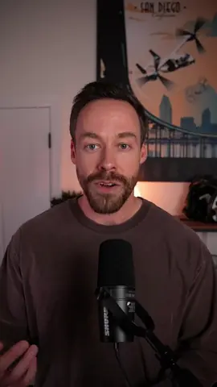</a>
<br><b>Freeze and mark</b><br><sub>The frame freezes, the room goes black and white, and marker circles you</sub>
</td>
<td width="25%" align="center" valign="top">
<a href="skills/vfx/SKILL.md">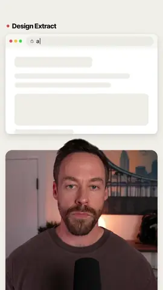</a>
<br><b>B-roll split</b><br><sub>A website or screenshot above you; you in the card below</sub>
</td>
</tr>
</table>

<!-- vfx:end -->

**The cut-out is picked for your computer.** `npm run setup -- --vfx` checks your machine and asks before downloading anything. With an NVIDIA card it installs [Robust Video Matting](https://github.com/PeterL1n/RobustVideoMatting) from its own GitHub (best edges, fast, about 2.5 GB; RVM is GPL-3.0, so it lives on your machine, not in this pack). On a Mac or any other computer it uses HyperFrames' own remover (Apache-2.0, about 170 MB, slower).

## The animations

Every clip here is a real render on sample content. For larger versions with each key moment and the command that runs it, [open the gallery](https://ctskool.github.io/chase-animations/).

<!-- animations:start -->

### Real routes

Route map on real streets, water and 3D buildings. Name two places or give it a GPX file.

<table>
<tr>
<td width="25%" align="center" valign="top">
<a href="blocks/route-map/README.md">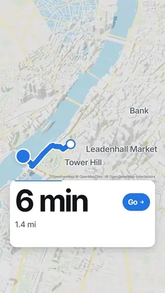</a>
<br><b>Tower Bridge to St Paul's</b><br><sub>A 1.4 mile walk through real London</sub>
</td>
<td width="25%" align="center" valign="top">
<a href="blocks/route-map/README.md">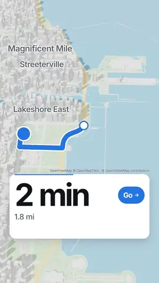</a>
<br><b>Millennium Park to Navy Pier</b><br><sub>A 1.8 mile drive along the Chicago lakefront</sub>
</td>
<td width="25%" align="center" valign="top">
<a href="blocks/route-map/README.md">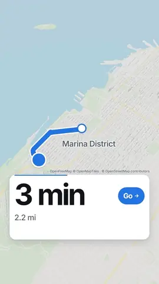</a>
<br><b>Palace of Fine Arts to the Wharf</b><br><sub>A 2.2 mile bike ride along the San Francisco bay</sub>
</td>
</tr>
</table>

### Big visuals

Spectacle that works for any topic. Each one turns an idea into something physical you can look at.

<table>
<tr>
<td width="25%" align="center" valign="top">
<a href="blocks/iceberg/README.md">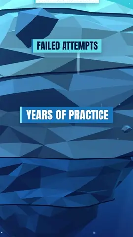</a>
<br><b><a href="blocks/iceberg/README.md"><code>iceberg</code></a></b><br><sub>A small tip hides a colossal mass under the waterline</sub>
</td>
<td width="25%" align="center" valign="top">
<a href="blocks/scale-reveal/README.md">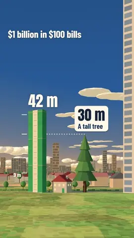</a>
<br><b><a href="blocks/scale-reveal/README.md"><code>scale-reveal</code></a></b><br><sub>A big number rises past real things at true scale</sub>
</td>
<td width="25%" align="center" valign="top">
<a href="blocks/cutaway/README.md">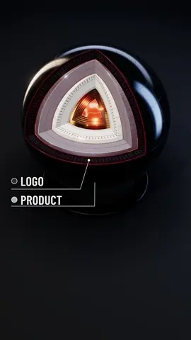</a>
<br><b><a href="blocks/cutaway/README.md"><code>cutaway</code></a></b><br><sub>A blade of light slices an object open down to its core</sub>
</td>
<td width="25%" align="center" valign="top">
<a href="blocks/campaign-map/README.md">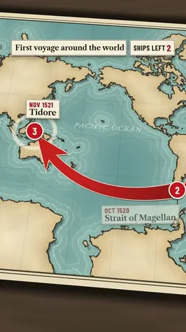</a>
<br><b><a href="blocks/campaign-map/README.md"><code>campaign-map</code></a></b><br><sub>Bold arrows sweep across a real map, like a history documentary</sub>
</td>
</tr>
</table>

### Compare and prove

<table>
<tr>
<td width="25%" align="center" valign="top">
<a href="blocks/head-to-head/README.md">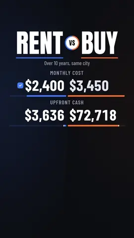</a>
<br><b><a href="blocks/head-to-head/README.md"><code>head-to-head</code></a></b><br><sub>Two options compared row by row, ending on one payoff stat</sub>
</td>
<td width="25%" align="center" valign="top">
<a href="blocks/before-after/README.md">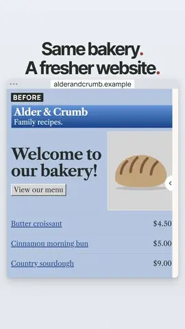</a>
<br><b><a href="blocks/before-after/README.md"><code>before-after</code></a></b><br><sub>A handle wipes a website from its old design to its new one</sub>
</td>
<td width="25%" align="center" valign="top">
<a href="blocks/ranking-bars/README.md">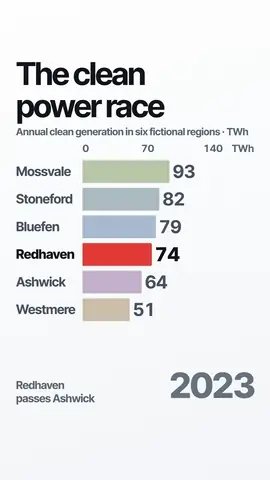</a>
<br><b><a href="blocks/ranking-bars/README.md"><code>ranking-bars</code></a></b><br><sub>Bars race through changing years with one hero to follow</sub>
</td>
<td width="25%" align="center" valign="top">
<a href="blocks/money-stat/README.md">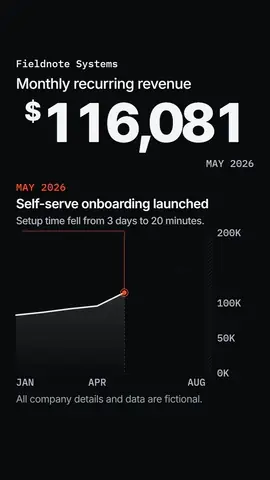</a>
<br><b><a href="blocks/money-stat/README.md"><code>money-stat</code></a></b><br><sub>One huge counter climbs a chart past its turning point</sub>
</td>
</tr>
<tr>
<td width="25%" align="center" valign="top">
<a href="blocks/notification-stack/README.md">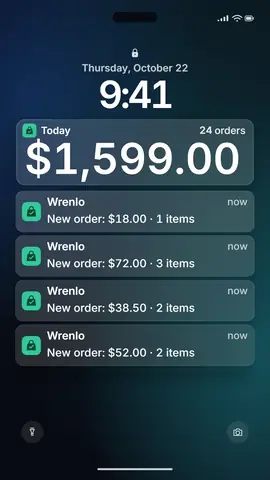</a>
<br><b><a href="blocks/notification-stack/README.md"><code>notification-stack</code></a></b><br><sub>Orders flood a lock screen while the total counts up</sub>
</td>
<td width="25%" align="center" valign="top">
<a href="blocks/post-receipt/README.md">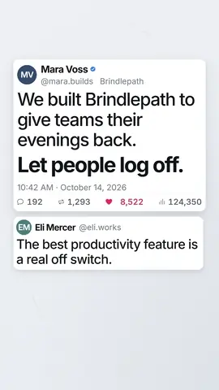</a>
<br><b><a href="blocks/post-receipt/README.md"><code>post-receipt</code></a></b><br><sub>A social post with racing counts and quote replies</sub>
</td>
<td width="25%" align="center" valign="top">
<a href="blocks/headline-highlight/README.md">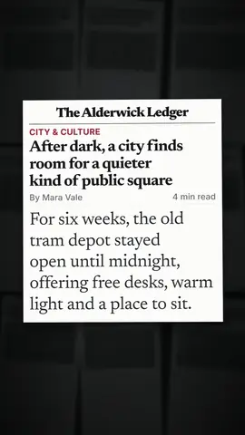</a>
<br><b><a href="blocks/headline-highlight/README.md"><code>headline-highlight</code></a></b><br><sub>A newspaper flies in and a highlighter marks the evidence</sub>
</td>
<td width="25%" align="center" valign="top">
<a href="blocks/evidence-desk/README.md">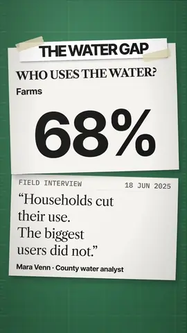</a>
<br><b><a href="blocks/evidence-desk/README.md"><code>evidence-desk</code></a></b><br><sub>Papers on a desk with a figure circled in red</sub>
</td>
</tr>
<tr>
<td width="25%" align="center" valign="top">
<a href="blocks/day-card/README.md">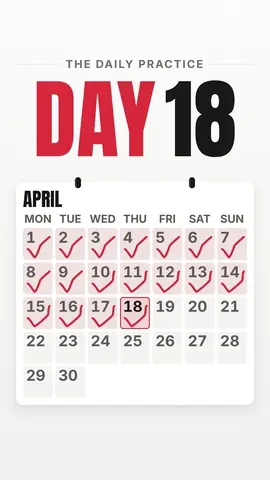</a>
<br><b><a href="blocks/day-card/README.md"><code>day-card</code></a></b><br><sub>A huge day counter stamps through a calendar</sub>
</td>
</tr>
</table>

### Products and apps

<table>
<tr>
<td width="25%" align="center" valign="top">
<a href="blocks/screen-zoom/README.md">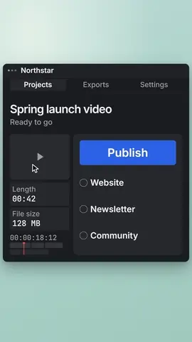</a>
<br><b><a href="blocks/screen-zoom/README.md"><code>screen-zoom</code></a></b><br><sub>The cursor leads the camera to one button, and it clicks</sub>
</td>
<td width="25%" align="center" valign="top">
<a href="blocks/app-launch/README.md">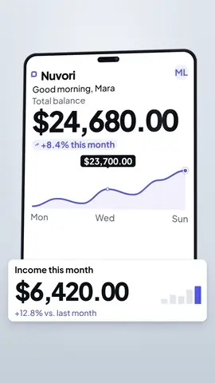</a>
<br><b><a href="blocks/app-launch/README.md"><code>app-launch</code></a></b><br><sub>A studio phone receives a transaction and completes it</sub>
</td>
<td width="25%" align="center" valign="top">
<a href="blocks/laptop-reveal/README.md">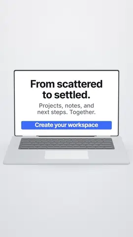</a>
<br><b><a href="blocks/laptop-reveal/README.md"><code>laptop-reveal</code></a></b><br><sub>A laptop opens, wakes on your product and scrolls it</sub>
</td>
<td width="25%" align="center" valign="top">
<a href="blocks/apple-one-take/README.md">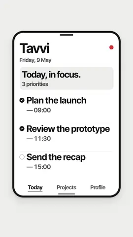</a>
<br><b><a href="blocks/apple-one-take/README.md"><code>apple-one-take</code></a></b><br><sub>A dot morphs through a button, a planner and a phone in one take</sub>
</td>
</tr>
<tr>
<td width="25%" align="center" valign="top">
<a href="blocks/frosted-glass/README.md">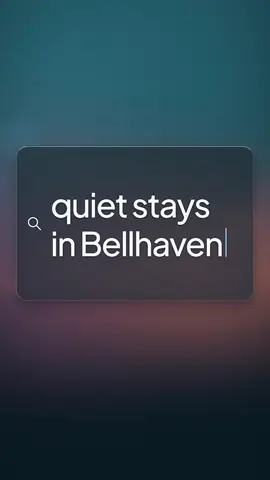</a>
<br><b><a href="blocks/frosted-glass/README.md"><code>frosted-glass</code></a></b><br><sub>A glass search bar docks above results and picks one</sub>
</td>
<td width="25%" align="center" valign="top">
<a href="blocks/exploded-teardown/README.md">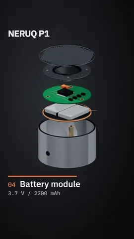</a>
<br><b><a href="blocks/exploded-teardown/README.md"><code>exploded-teardown</code></a></b><br><sub>A product opens into labelled layers</sub>
</td>
</tr>
</table>

### Explain a process or place

<table>
<tr>
<td width="25%" align="center" valign="top">
<a href="blocks/isometric-flow/README.md">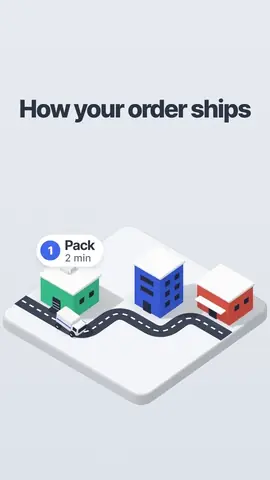</a>
<br><b><a href="blocks/isometric-flow/README.md"><code>isometric-flow</code></a></b><br><sub>A 3D diorama of a three-step process</sub>
</td>
<td width="25%" align="center" valign="top">
<a href="blocks/timeline-3d/README.md">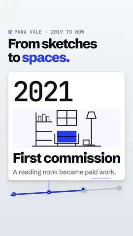</a>
<br><b><a href="blocks/timeline-3d/README.md"><code>timeline-3d</code></a></b><br><sub>A moving rail passes oversized milestone cards</sub>
</td>
<td width="25%" align="center" valign="top">
<a href="blocks/globe-arcs/README.md">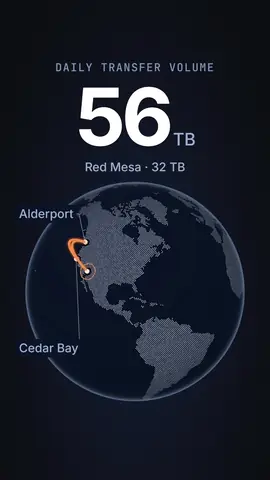</a>
<br><b><a href="blocks/globe-arcs/README.md"><code>globe-arcs</code></a></b><br><sub>Routes cross a dotted globe while a figure counts up</sub>
</td>
<td width="25%" align="center" valign="top">
<a href="blocks/route-map/README.md">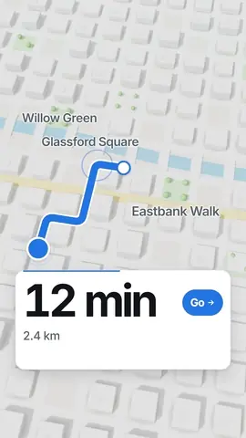</a>
<br><b><a href="blocks/route-map/README.md"><code>route-map</code></a></b><br><sub>A route draws through a pale 3D city, fictional or real, with live trip stats</sub>
</td>
</tr>
<tr>
<td width="25%" align="center" valign="top">
<a href="blocks/pencil-blueprint/README.md">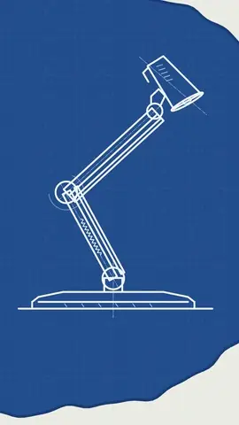</a>
<br><b><a href="blocks/pencil-blueprint/README.md"><code>pencil-blueprint</code></a></b><br><sub>A graphite sketch becomes a white-on-blue technical drawing</sub>
</td>
</tr>
</table>

### Styled titles

<table>
<tr>
<td width="25%" align="center" valign="top">
<a href="blocks/blue-editorial/README.md">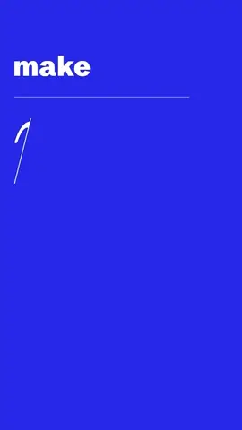</a>
<br><b><a href="blocks/blue-editorial/README.md"><code>blue-editorial</code></a></b><br><sub>An ultramarine cover with frame-filling italic words</sub>
</td>
<td width="25%" align="center" valign="top">
<a href="blocks/swiss-grid/README.md">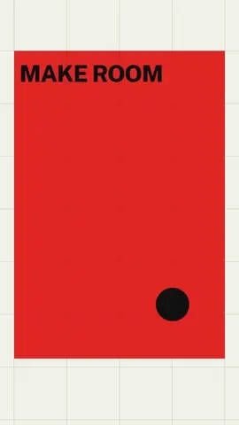</a>
<br><b><a href="blocks/swiss-grid/README.md"><code>swiss-grid</code></a></b><br><sub>A black circle and red field in a strict Swiss grid</sub>
</td>
<td width="25%" align="center" valign="top">
<a href="blocks/magazine-layout/README.md"></a>
<br><b><a href="blocks/magazine-layout/README.md"><code>magazine-layout</code></a></b><br><sub>A painted image, a serif headline and a real text column</sub>
</td>
<td width="25%" align="center" valign="top">
<a href="blocks/risograph/README.md"></a>
<br><b><a href="blocks/risograph/README.md"><code>risograph</code></a></b><br><sub>A two-ink poster prints in stepped passes</sub>
</td>
</tr>
<tr>
<td width="25%" align="center" valign="top">
<a href="blocks/ink-wash/README.md"></a>
<br><b><a href="blocks/ink-wash/README.md"><code>ink-wash</code></a></b><br><sub>Mountains, a red sun and a small boat on rice paper</sub>
</td>
<td width="25%" align="center" valign="top">
<a href="blocks/glow-orb/README.md"></a>
<br><b><a href="blocks/glow-orb/README.md"><code>glow-orb</code></a></b><br><sub>A soft breathing orb above one line of type</sub>
</td>
<td width="25%" align="center" valign="top">
<a href="blocks/retro-crt/README.md"></a>
<br><b><a href="blocks/retro-crt/README.md"><code>retro-crt</code></a></b><br><sub>A beam opens into a huge phosphor title with a terminal line</sub>
</td>
<td width="25%" align="center" valign="top">
<a href="blocks/oscilloscope/README.md"></a>
<br><b><a href="blocks/oscilloscope/README.md"><code>oscilloscope</code></a></b><br><sub>A green signal folds through figures and writes your words</sub>
</td>
</tr>
</table>

### Claude Code

These use Claude Code's look, the Claude logo and its pixel mascot. They run on sample content until you tell Claude what to show, and you can turn the mascot or logo off.

<table>
<tr>
<td width="25%" align="center" valign="top">
<a href="blocks/terminal-run/README.md"></a>
<br><b><a href="blocks/terminal-run/README.md"><code>terminal-run</code></a></b><br><sub>A session plays out from one prompt to a finished result</sub>
</td>
<td width="25%" align="center" valign="top">
<a href="blocks/agent-fan-out/README.md"></a>
<br><b><a href="blocks/agent-fan-out/README.md"><code>agent-fan-out</code></a></b><br><sub>One prompt splits into six subagents, each with its own mascot</sub>
</td>
<td width="25%" align="center" valign="top">
<a href="blocks/agent-loop/README.md"></a>
<br><b><a href="blocks/agent-loop/README.md"><code>agent-loop</code></a></b><br><sub>The mascot laps Plan, Act and Check until the tests pass</sub>
</td>
<td width="25%" align="center" valign="top">
<a href="blocks/test-sweep/README.md"></a>
<br><b><a href="blocks/test-sweep/README.md"><code>test-sweep</code></a></b><br><sub>A wall of failing tests flips green in a wave</sub>
</td>
</tr>
<tr>
<td width="25%" align="center" valign="top">
<a href="blocks/bug-hunt/README.md"></a>
<br><b><a href="blocks/bug-hunt/README.md"><code>bug-hunt</code></a></b><br><sub>The mascot surfs a scrolling file until it finds the bug</sub>
</td>
<td width="25%" align="center" valign="top">
<a href="blocks/file-tree/README.md"></a>
<br><b><a href="blocks/file-tree/README.md"><code>file-tree</code></a></b><br><sub>A codebase grows branch by branch behind the mascot</sub>
</td>
<td width="25%" align="center" valign="top">
<a href="blocks/diff-reveal/README.md"></a>
<br><b><a href="blocks/diff-reveal/README.md"><code>diff-reveal</code></a></b><br><sub>The mascot eats the red lines of a real-looking diff</sub>
</td>
<td width="25%" align="center" valign="top">
<a href="blocks/hours-collapse/README.md"></a>
<br><b><a href="blocks/hours-collapse/README.md"><code>hours-collapse</code></a></b><br><sub>A full day of hour blocks gets stomped into minutes</sub>
</td>
</tr>
<tr>
<td width="25%" align="center" valign="top">
<a href="blocks/cost-receipt/README.md"></a>
<br><b><a href="blocks/cost-receipt/README.md"><code>cost-receipt</code></a></b><br><sub>A till receipt prints line items for a session</sub>
</td>
<td width="25%" align="center" valign="top">
<a href="blocks/benchmark-takeover/README.md"></a>
<br><b><a href="blocks/benchmark-takeover/README.md"><code>benchmark-takeover</code></a></b><br><sub>The mascot rides a huge row into a serious leaderboard</sub>
</td>
</tr>
</table>

<!-- animations:end -->

## Start here

You need [Claude Code](https://claude.com/claude-code), [Node.js 22 or newer](https://nodejs.org) and FFmpeg.

```bash
git clone https://github.com/ctskool/chase-animations.git
```

```bash
cd chase-animations
```

```bash
npm install
```

```bash
npm run setup
```

Restart Claude Code and type `/animate`, `/explain` or `/vfx`. To land animations on a spoken word, and for `/explain` and `/vfx`, also add the speech model, about 640 MB, which runs on your computer:

```bash
npm run setup -- --speech
```

For `/vfx`, also add the cut-out model picked for your computer. It tells you what it will download first:

```bash
npm run setup -- --vfx
```

[docs/INSTALL.md](docs/INSTALL.md) has the full guide and fixes for common problems. Prefer the terminal? [docs/COMMANDS.md](docs/COMMANDS.md) has every command.

## How it's built


All three skills share one engine: the same HyperFrames rendering, the same on-device transcription and the same frame check.

- **`/animate`** works from a library of finished animations, called blocks. Each block is one tested animation with variables for your content. Each block also has a typed shortcut, such as `/animate-cutaway`, that runs the main skill for that block, so a fix lives in one place.
- **`/explain`** works from a kit of scene types rather than finished blocks, because a whole explainer needs many short scenes that change with every topic. Claude picks scenes from the kit, fills them in for your topic, and times each one to your recording.
- **`/vfx`** works from effects, built like blocks but drawn in two layers, one behind you and one in front. Your cut-out goes between them, and a head track taken from the cut-out lets each layer follow you.

| Folder | What's in it |
|---|---|
| [`blocks/`](blocks) | The 42 animations, each with its own README on what it suits and how to feed it |
| [`explain-kit/`](explain-kit) | The `/explain` scene kit, captions and five example scripts |
| [`effects/`](effects) | The `/vfx` effects |
| [`examples/vfx/`](examples/vfx) | Reference footage: a 15 second sample to try `/vfx` on, and the finished 85 second video |
| [`skills/`](skills) | `/animate`, its 42 shortcuts, `/explain` and `/vfx` |
| [`shared/`](shared) | Rendering, word sync, real maps, the explainer builder, the effects engine and the `animate` command |
| [`gallery/`](gallery) | The gallery page, its clips and the catalogue behind it |
| [`docs/`](docs) | Install guide, commands and credits |
| [`scripts/`](scripts) | Builders for the gallery, banner and promo video. Not needed to use the pack |

## What works where

| System | Status |
|---|---|
| Windows 11 | Tested, including `/vfx` with RVM and with HyperFrames' remover |
| Mac | Tested on an Apple Silicon MacBook Air: setup, `/animate`, `/explain` and `/vfx` with HyperFrames' remover. Install `ffmpeg-full` from Homebrew, not `ffmpeg` |
| Linux | Untested |

## Credits

Fonts, map data and third-party licences are listed in [docs/CREDITS.md](docs/CREDITS.md). Claude, Claude Code, the Claude logo and the Claude Code mascot are Anthropic's, and this pack isn't affiliated with or endorsed by Anthropic.
